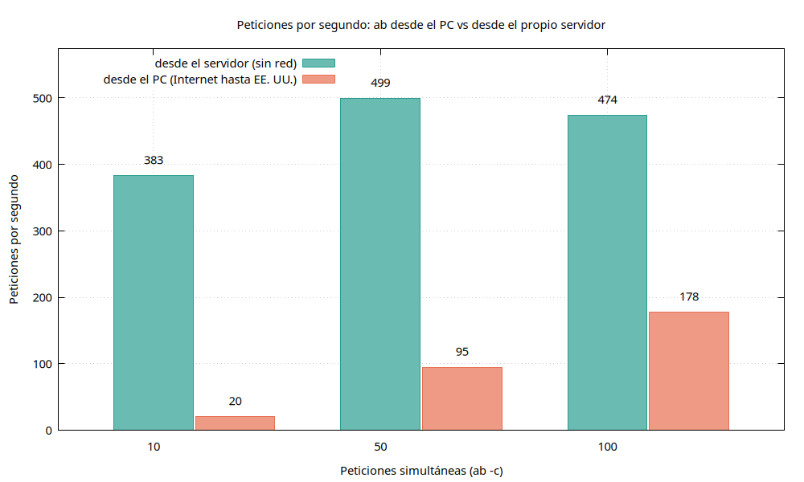
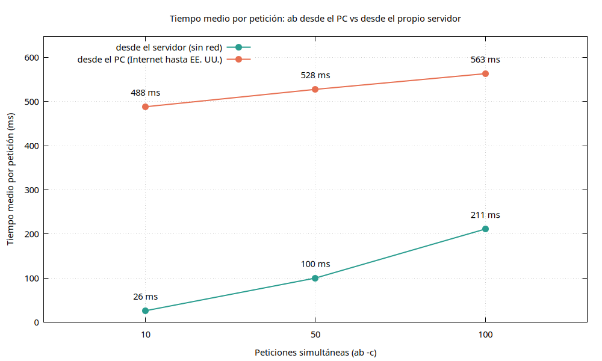
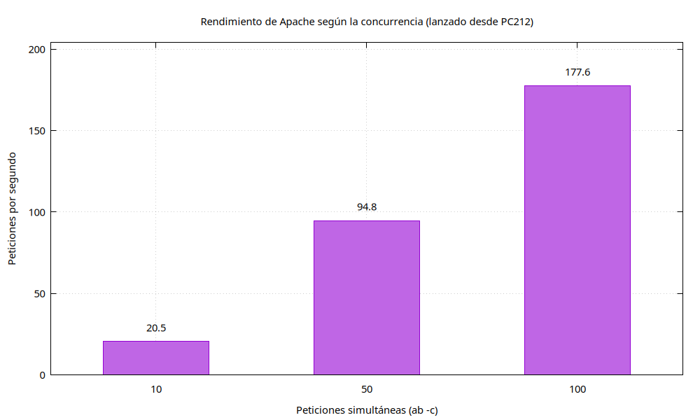
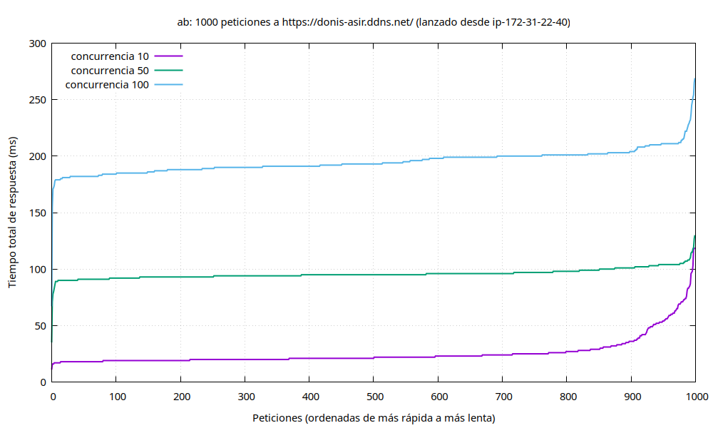

# Apache en AWS con dominio y HTTPS (Let's Encrypt) + benchmark con ab y gnuplot

Práctica de **Servicios en Red** (2º ASIR): servidor web Apache en una instancia
EC2 de AWS, con un nombre de dominio dinámico y certificado HTTPS gratuito
obtenido con Certbot. Como ampliación, se mide su rendimiento con **ApacheBench
(`ab`)** y se grafican los resultados con **gnuplot**.

## Infraestructura

| Pieza | Detalle |
|---|---|
| Servidor | AWS EC2 (AWS Academy Learner Lab, us-east-1), Debian, IP elástica |
| Web | Apache 2.4, VirtualHost propio para `donis-asir.ddns.net` |
| Dominio | No-IP (DNS dinámico gratuito), registro `A` hacia la IP elástica |
| Certificado | Let's Encrypt con `certbot --apache` (clave ECDSA, renovación automática) |
| Red | Grupo de seguridad con 80 y 443 abiertos; HTTP redirige a HTTPS (301) |

La página (`index.html`) detecta en el navegador si la conexión es HTTP o
HTTPS y lo muestra en vivo.

## Pasos principales

```bash
# Apache
sudo apt update && sudo apt install apache2

# VirtualHost (puerto 80) en /etc/apache2/sites-available/donis-asir.ddns.net.conf
sudo a2ensite donis-asir.ddns.net.conf
sudo systemctl reload apache2

# Certificado HTTPS
sudo apt install certbot python3-certbot-apache
sudo certbot --apache -d donis-asir.ddns.net   # crea el VirtualHost 443 y la redirección 301

# Comprobaciones
sudo certbot certificates
sudo certbot renew --dry-run                   # "all simulated renewals succeeded"
curl -I http://donis-asir.ddns.net             # 301 -> https://
```

## Benchmark con ab + gnuplot

En [`benchmark/`](benchmark/):

- [`benchmark.sh`](benchmark/benchmark.sh): lanza `ab -n 1000` con concurrencia
  10, 50 y 100 contra `https://donis-asir.ddns.net/`, guardando cada petición
  con `ab -g` (formato para gnuplot), y genera las gráficas.
- [`graficas.gp`](benchmark/graficas.gp): tiempo de respuesta de cada petición
  (ordenadas) y peticiones por segundo según la concurrencia.
- [`comparativa.gp`](benchmark/comparativa.gp): compara las dos ejecuciones.

Se ejecutó **desde dos sitios**: desde el PC del aula (cliente real, a través
de Internet hasta EE. UU.) y desde el propio servidor (sin red de por medio).
Los resultados completos de `ab` están en [`benchmark/pc/`](benchmark/pc/) y
[`benchmark/servidor/`](benchmark/servidor/).

### Resultados

| Concurrencia | PC: pet/s | PC: ms/petición | Servidor: pet/s | Servidor: ms/petición |
|---:|---:|---:|---:|---:|
| 10  | 20,5  | 488 | 383 | 26  |
| 50  | 94,8  | 528 | 499 | 100 |
| 100 | 177,6 | 563 | 474 | 211 |

0 peticiones fallidas en todas las pruebas.




### Conclusiones

- **Desde el PC el límite es la distancia.** Cada petición tarda ~480 ms casi
  sin importar la concurrencia: ~220 ms en conectar (TCP + negociación TLS) y
  ~260 ms en recibir la página, casi todo viaje de ida y vuelta a Virginia.
  Las peticiones/s crecen en proporción a la concurrencia, así que el servidor
  nunca llegó a saturarse.
- **Desde el servidor se ve el límite real: ~500 peticiones HTTPS/s.** A partir
  de concurrencia 50 ya no sube más, y el tiempo por petición crece en
  proporción (26 → 100 → 211 ms): las peticiones esperan en cola.
- **El cuello de botella es la CPU.** `ab` abre una conexión nueva por petición,
  así que cada una exige una negociación TLS completa; además `ab` compite por
  la CPU con Apache en la misma instancia, por lo que el límite real de Apache
  es algo mayor que el medido.

## Capturas

| Benchmark desde el PC | Benchmark desde el servidor |
|---|---|
|  |  |

Gráficas individuales de cada ejecución:

| | Tiempos de respuesta | Peticiones por segundo |
|---|---|---|
| PC |  |  |
| Servidor |  |  |

## Reproducirlo

```bash
sudo apt install apache2-utils gnuplot   # en un servidor sin escritorio: gnuplot-nox
cd benchmark
./benchmark.sh                           # cambia URL dentro del script para otro sitio
```

> El servidor de AWS y el dominio se eliminan al terminar la práctica, así que
> es posible que `donis-asir.ddns.net` ya no responda.
