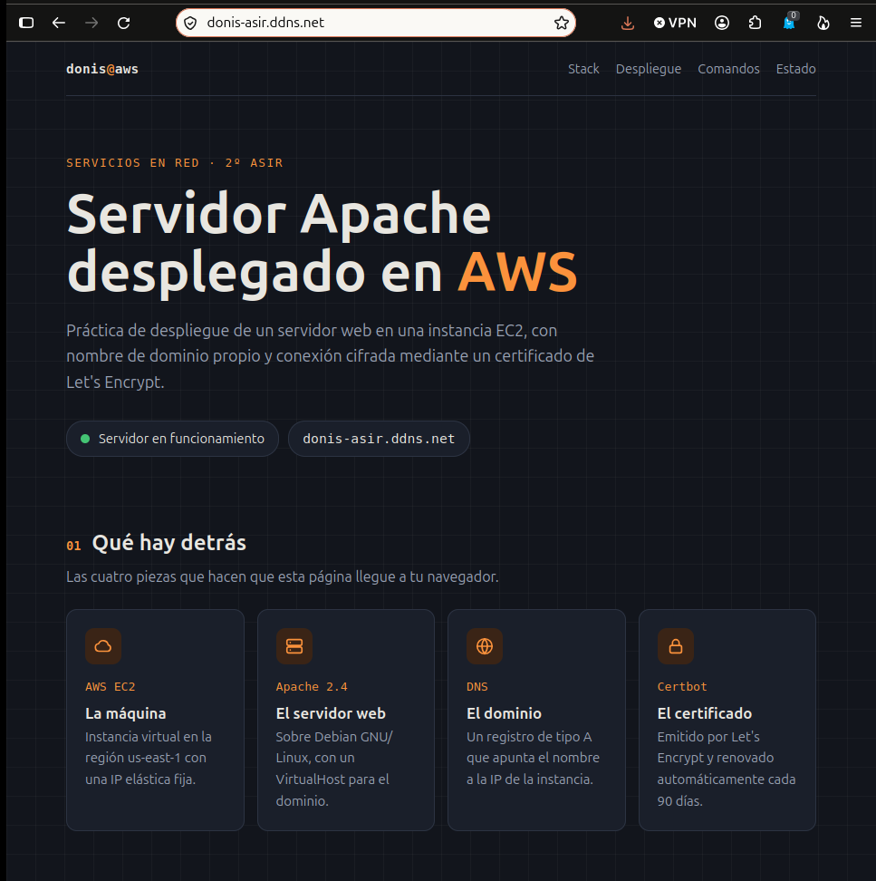
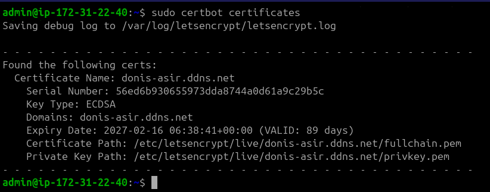
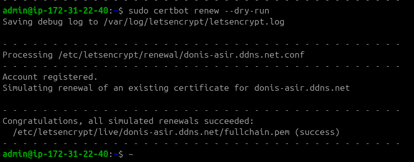
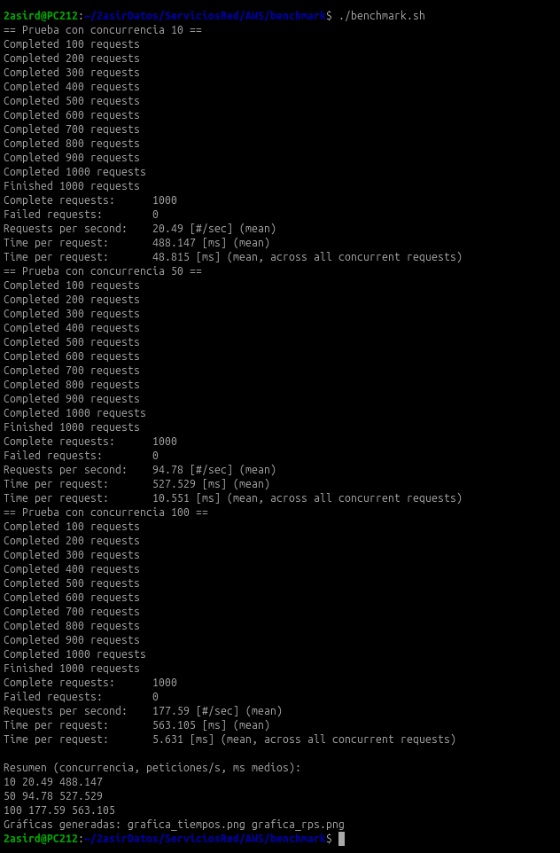
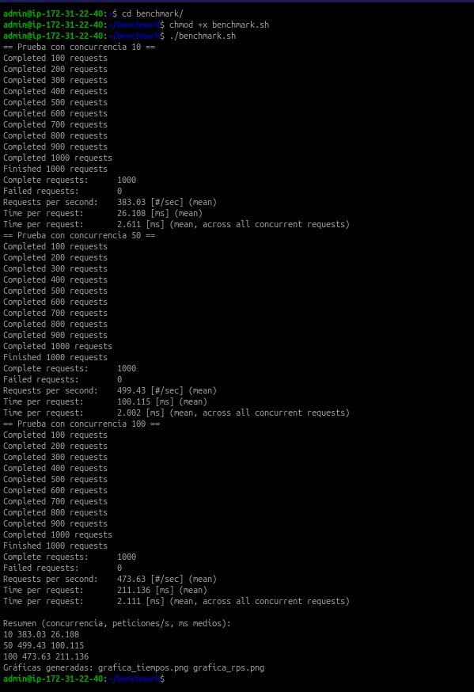
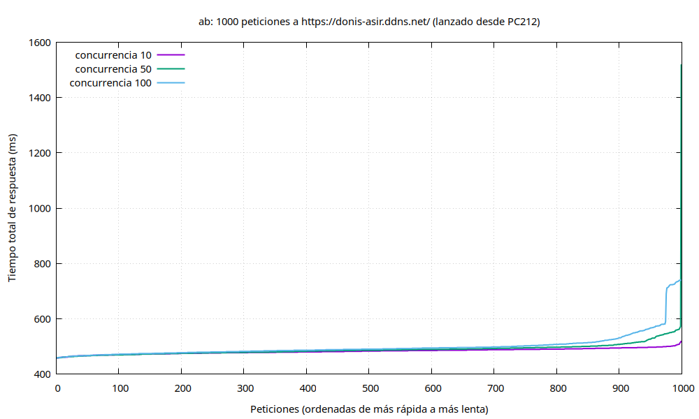
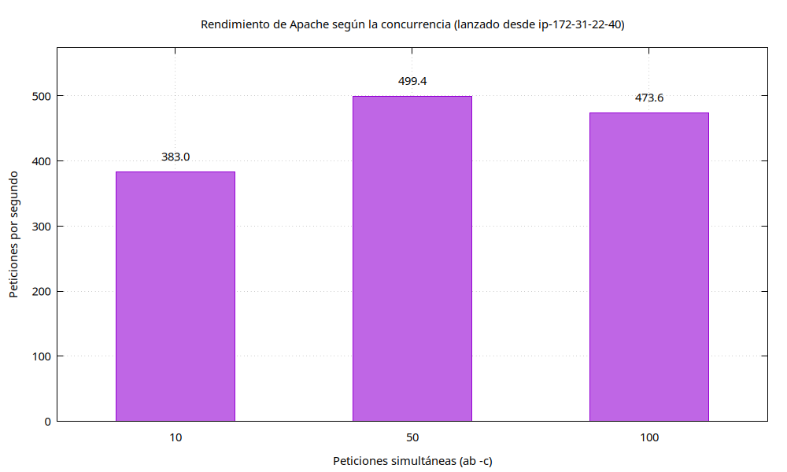

# Apache en AWS con dominio y HTTPS (Let's Encrypt) + benchmark con ab y gnuplot

Práctica de **Servicios en Red** (2º ASIR): servidor web Apache en una instancia
EC2 de AWS, con un nombre de dominio dinámico y certificado HTTPS gratuito
obtenido con Certbot. Como ampliación, se mide su rendimiento con **ApacheBench
(`ab`)** y se grafican los resultados con **gnuplot**.



## Infraestructura

| Pieza | Detalle |
|---|---|
| Servidor | AWS EC2 (AWS Academy Learner Lab, us-east-1), Debian, IP elástica |
| Web | Apache 2.4, VirtualHost propio para `donis-asir.ddns.net` |
| Proxy | HAProxy 3.0 delante de dos Apache (balanceo `roundrobin`, HTTPS en el proxy) |
| Dominio | No-IP (DNS dinámico gratuito), registro `A` hacia la IP elástica |
| Certificado | Let's Encrypt con `certbot --apache` (clave ECDSA, renovación automática) |
| Red | Grupo de seguridad con 80 y 443 abiertos; HTTP redirige a HTTPS (301) |

La página (`index.html`) detecta en el navegador si la conexión es HTTP o
HTTPS y lo muestra en vivo.

## Cómo encajan las piezas

```
Navegador ──DNS──▶ No-IP: donis-asir.ddns.net = 34.207.154.160
    │
    └──HTTPS (443)──▶ Grupo de seguridad AWS ──▶ EC2 Debian ──▶ HAProxy ──┬──▶ Apache 1 (:8081)
                                                                │       └──▶ Apache 2 (:8082)
                                                                └─ certificado de Let's Encrypt
                                                                   (obtenido y renovado por Certbot)
```

Las secciones 1–4 son el montaje inicial (Apache sirviendo directamente en
80/443); la 5 añade HAProxy delante y cambia lo necesario.

Cada paso depende del anterior: sin IP fija el dominio se queda apuntando a
una IP vieja, y sin dominio no hay certificado (Let's Encrypt no emite
certificados para direcciones IP sueltas, solo para nombres de dominio).

## 1. Instancia EC2

- Instancia Debian lanzada desde el AWS Academy Learner Lab (región
  `us-east-1`), acceso por SSH con el usuario `admin` y un par de claves `.pem`.
- **Grupo de seguridad** (el cortafuegos de AWS): reglas de entrada para
  **22** (SSH), **80** (HTTP) y **443** (HTTPS) desde `0.0.0.0/0`. El 80 hace
  falta aunque la web vaya por HTTPS: Let's Encrypt valida el dominio por ahí
  y además sirve para redirigir a quien entre por `http://`.
- **IP elástica** (EC2 → *Elastic IPs* → *Allocate* → *Associate*): una IP
  pública fija. Sin ella, AWS asigna una IP distinta cada vez que se para y
  arranca la instancia (el laboratorio se apaga solo al acabar la sesión), y
  habría que cambiar el DNS cada vez.

## 2. Dominio con No-IP

[No-IP](https://www.noip.com/) es un servicio de **DNS dinámico**: da gratis un
subdominio de sus dominios (`ddns.net`, `hopto.org`…) y permite apuntarlo a
cualquier IP. Pensado para conexiones domésticas cuya IP cambia, sirve
igualmente para un servidor en la nube.

Pasos:

1. Crear una cuenta gratuita en No-IP.
2. *Dynamic DNS* → *No-IP Hostnames* → *Create Hostname*.
3. Hostname `donis-asir`, dominio `ddns.net`, tipo de registro **A**
   (nombre → dirección IPv4) y como IP la IP elástica de la instancia.

Comprobación desde cualquier equipo (puede tardar unos minutos en propagarse):

```bash
dig +short donis-asir.ddns.net     # o: nslookup donis-asir.ddns.net
# 34.207.154.160
```

> La cuenta gratuita de No-IP envía un correo cada 30 días para confirmar que
> el hostname sigue en uso; si no se confirma, lo elimina.

## 3. Apache y VirtualHost

```bash
sudo apt update && sudo apt install apache2
```

En lugar de usar el sitio por defecto se crea un **VirtualHost** propio para
el dominio en `/etc/apache2/sites-available/donis-asir.ddns.net.conf`:

```apache
<VirtualHost *:80>
    ServerName donis-asir.ddns.net
    DocumentRoot /var/www/html
</VirtualHost>
```

(Sin `ErrorLog`/`CustomLog` propios: se usan los generales de Apache,
`/var/log/apache2/error.log` y `access.log`.)

El `ServerName` es importante: es lo que Certbot busca después para saber qué
VirtualHost tiene que convertir a HTTPS.

```bash
sudo a2ensite donis-asir.ddns.net.conf
sudo apache2ctl configtest          # "Syntax OK"
sudo systemctl reload apache2
```

La página ([`index.html`](index.html)) se sube con `scp` y se copia a
`/var/www/html/`.

## 4. HTTPS con Certbot y Let's Encrypt

**Let's Encrypt** es una autoridad de certificación gratuita y automatizada,
reconocida por todos los navegadores. **Certbot** es su cliente oficial: pide
el certificado, demuestra que controlamos el dominio y configura el servidor
web.

```bash
sudo apt install certbot python3-certbot-apache
sudo certbot --apache -d donis-asir.ddns.net
```

### Qué pasa al ejecutar `certbot --apache`

1. **Validación del dominio (reto HTTP-01 del protocolo ACME).** Let's Encrypt
   le da a Certbot un *token*; Certbot lo publica temporalmente en
   `http://donis-asir.ddns.net/.well-known/acme-challenge/<token>` y los
   servidores de Let's Encrypt lo descargan desde Internet. Si lo encuentran,
   queda demostrado que quien pide el certificado controla el servidor al que
   apunta el dominio. Por eso, antes de lanzar Certbot, **el DNS tiene que
   resolver a la IP correcta y el puerto 80 tiene que estar abierto**.
2. **Emisión del certificado.** Se guarda en `/etc/letsencrypt/live/donis-asir.ddns.net/`:
   - `fullchain.pem`: certificado del dominio + certificado intermedio de Let's Encrypt.
   - `privkey.pem`: clave privada (**ECDSA**, la que usa Certbot por defecto).
3. **Configuración de Apache.** El plugin `--apache`:
   - Activa `mod_ssl` y crea `donis-asir.ddns.net-le-ssl.conf`, una copia del
     VirtualHost en el puerto **443** con el certificado:

     ```apache
     <IfModule mod_ssl.c>
     <VirtualHost *:443>
         ServerName donis-asir.ddns.net
         DocumentRoot /var/www/html

     SSLCertificateFile /etc/letsencrypt/live/donis-asir.ddns.net/fullchain.pem
     SSLCertificateKeyFile /etc/letsencrypt/live/donis-asir.ddns.net/privkey.pem
     Include /etc/letsencrypt/options-ssl-apache.conf
     </VirtualHost>
     </IfModule>
     ```

     `options-ssl-apache.conf` lo mantiene Certbot y fija protocolos y
     cifrados seguros (sin SSLv3, TLS 1.0 ni 1.1).
   - Añade al VirtualHost del puerto 80 una **redirección permanente (301)** a
     HTTPS, que queda así:

     ```apache
     <VirtualHost *:80>
         ServerName donis-asir.ddns.net
         DocumentRoot /var/www/html
     RewriteEngine on
     RewriteCond %{SERVER_NAME} =donis-asir.ddns.net
     RewriteRule ^ https://%{SERVER_NAME}%{REQUEST_URI} [END,NE,R=permanent]
     </VirtualHost>
     ```

### Renovación automática

Los certificados de Let's Encrypt **duran 90 días** (a propósito: obliga a
automatizar la renovación). El paquete de Debian instala un temporizador de
systemd, `certbot.timer`, que ejecuta `certbot renew` dos veces al día; solo
renueva cuando quedan menos de 30 días, así que no hay que hacer nada a mano.

```bash
systemctl list-timers certbot.timer   # cuándo se ejecuta la próxima vez
```

### Comprobaciones

```bash
sudo certbot certificates
#   Certificate Name: donis-asir.ddns.net
#   Key Type: ECDSA
#   Domains: donis-asir.ddns.net
#   Expiry Date: 2027-02-16 ... (VALID: 89 days)

sudo certbot renew --dry-run          # simula la renovación contra el entorno de pruebas
#   Congratulations, all simulated renewals succeeded

curl -I http://donis-asir.ddns.net    # HTTP/1.1 301 Moved Permanently
                                      # Location: https://donis-asir.ddns.net/
curl -I https://donis-asir.ddns.net   # HTTP/1.1 200 OK
```

| `certbot certificates` | `certbot renew --dry-run` |
|---|---|
|  |  |

> En la captura sale la **ruta** de la clave privada, no su contenido. La ruta
> es la misma en cualquier servidor con Certbot; el certificado en sí es
> público (se envía a cada visitante y aparece en los registros de
> Certificate Transparency, p. ej. [crt.sh](https://crt.sh/?q=donis-asir.ddns.net)).

En el navegador aparece el candado y, en los detalles del certificado, el
emisor es Let's Encrypt. La propia página muestra **"HTTPS (cifrada)"** (lo
detecta con JavaScript a partir de `location.protocol`).

## 5. Balanceo de carga con HAProxy

[HAProxy](https://www.haproxy.org/) es un **proxy inverso y balanceador de
carga**: recibe todas las conexiones de los clientes y las reparte entre
varios servidores web, que quedan ocultos detrás. En un despliegue real serían
varias máquinas; aquí, para no crear otra instancia, son **dos Apache en la
misma EC2**, cada uno en un puerto local.

| Antes | Después |
|---|---|
| Apache escucha en 80 y 443 y hace el HTTPS | **HAProxy** escucha en 80 y 443 y hace el HTTPS |
| | Apache escucha solo en `127.0.0.1:8081` y `127.0.0.1:8082` (inaccesible desde fuera) |
| Certbot valida y configura a través de Apache | Certbot valida en modo *standalone*; HAProxy le pasa el reto |

Todos los ficheros están en [`haproxy/`](haproxy/).

### Apache: dos servidores en local

[`ports.conf`](haproxy/ports.conf) deja a Apache escuchando solo en local, y
[`servidores.conf`](haproxy/servidores.conf) define un VirtualHost por puerto,
cada uno con su carpeta (`/var/www/servidor1` y `/var/www/servidor2`, con el
mismo `index.html`).

Para que se vea qué servidor responde, cada VirtualHost define una variable
(`SetEnv SERVIDOR "Apache 1 (puerto 8081)"`) y la página la imprime con
**SSI** (`mod_include`): `<!--#echo var="SERVIDOR" -->`. Tiene que ir en el
propio HTML: si la página la pidiera en una segunda petición, el balanceo la
mandaría al *otro* servidor.

Como ahora todas las conexiones a Apache vienen de HAProxy (`127.0.0.1`),
`mod_remoteip` lee la cabecera `X-Forwarded-For` para que los logs guarden la
IP real del cliente.

```bash
sudo a2dissite 000-default donis-asir.ddns.net donis-asir.ddns.net-le-ssl
sudo a2ensite servidores
sudo a2enmod include remoteip
sudo apache2ctl configtest && sudo systemctl restart apache2
```

### HAProxy

```bash
sudo apt install haproxy
```

HAProxy quiere el certificado y la clave **en un solo fichero**:

```bash
sudo mkdir -p /etc/haproxy/certs
sudo sh -c 'cat /etc/letsencrypt/live/donis-asir.ddns.net/fullchain.pem \
                /etc/letsencrypt/live/donis-asir.ddns.net/privkey.pem \
              > /etc/haproxy/certs/donis-asir.ddns.net.pem'
sudo chmod 600 /etc/haproxy/certs/donis-asir.ddns.net.pem
```

La configuración ([`haproxy.cfg`](haproxy/haproxy.cfg)) tiene dos partes:

- **`frontend web`** (la entrada): escucha en 80 y 443 con el certificado,
  redirige HTTP → HTTPS (301), manda el reto de Let's Encrypt a Certbot y el
  resto a los Apache.
- **`backend apaches`** (la salida): los dos Apache con `balance roundrobin`
  (uno y uno) y `check`: HAProxy comprueba cada pocos segundos que responden
  (`option httpchk GET /`) y deja de enviar tráfico al que se caiga. Además
  añade la cabecera `X-Servidor` con el nombre del que respondió.

```bash
sudo haproxy -c -f /etc/haproxy/haproxy.cfg     # comprobar la sintaxis
sudo systemctl restart haproxy
```

> Detalle que avisó `haproxy -c`: las reglas `http-request` (como la
> redirección a HTTPS) se ejecutan **antes** que `use_backend`, aunque estén
> escritas después. Por eso la redirección excluye explícitamente
> `/.well-known/acme-challenge/`.

### Certbot detrás de HAProxy

`certbot --apache` ya no sirve: Apache no está en el puerto 80. Se cambia la
renovación a modo **standalone**: Certbot levanta su propio mini servidor web
en `127.0.0.1:8888` solo durante la renovación, y HAProxy le reenvía las
peticiones a `/.well-known/acme-challenge/`.

```bash
sudo certbot reconfigure --cert-name donis-asir.ddns.net \
     --standalone --http-01-port 8888 --http-01-address 127.0.0.1
# y quitar la línea "installer = apache" de /etc/letsencrypt/renewal/donis-asir.ddns.net.conf
```

Tras renovar hay que volver a juntar certificado y clave y recargar HAProxy.
De eso se encarga un *deploy hook*
([`haproxy-deploy-hook.sh`](haproxy/haproxy-deploy-hook.sh)) en
`/etc/letsencrypt/renewal-hooks/deploy/`, que Certbot ejecuta tras cada
renovación con éxito.

```bash
sudo certbot renew --dry-run --run-deploy-hooks
#   Congratulations, all simulated renewals succeeded
```

### Comprobaciones

```bash
for i in 1 2 3 4; do curl -sI https://donis-asir.ddns.net/ | grep -i x-servidor; done
#   x-servidor: servidor1
#   x-servidor: servidor2
#   x-servidor: servidor1
#   x-servidor: servidor2

curl -I http://donis-asir.ddns.net/      # 301 -> https:// (ahora lo hace HAProxy)
sudo ss -ltnp | grep -E ':(80|443|8081|8082) '
#   0.0.0.0:80       haproxy
#   0.0.0.0:443      haproxy
#   127.0.0.1:8081   apache2
#   127.0.0.1:8082   apache2
```

En el navegador, recargando la página, el campo **"Servidor que responde"**
va alternando entre Apache 1 y Apache 2. Además, ahora la conexión va por
**HTTP/2** y **TLS 1.3** (HAProxy lo negocia con `alpn h2,http/1.1`).

### Página de estadísticas

En `https://donis-asir.ddns.net/estadisticas` (con usuario y contraseña)
HAProxy muestra en vivo el estado de cada servidor (verde = responde a los
*health checks*) y las sesiones y peticiones que ha atendido cada uno. Con
`stats admin` se puede además poner un servidor en mantenimiento desde la
propia página (casilla del servidor → *Set state to MAINT* → *Apply*).

### Tolerancia a fallos

El *health check* pide `/index.html` a cada Apache cada 2 s. Para simular que
un servidor se estropea se le quita la web:

```bash
sudo mv /var/www/servidor1/index.html /var/www/servidor1/index.html.off
sudo journalctl -u haproxy -f
#   Server apaches/servidor1 is DOWN, reason: Layer7 wrong status, code: 404 ...
#   1 active and 0 backup servers left.
```

A partir de ahí todas las peticiones van a `servidor2` (siguen saliendo
200, el cliente no nota nada). Al devolver el fichero:

```bash
sudo mv /var/www/servidor1/index.html.off /var/www/servidor1/index.html
#   Server apaches/servidor1 is UP, reason: Layer7 check passed, code: 200
#   2 active and 0 backup servers online.
```

> Con `GET /` no funcionaba: sin `index.html`, Apache devuelve el listado del
> directorio con un 200 y HAProxy seguía dándolo por bueno.

## Problemas encontrados

- **`index.html` corrupto al pegarlo con `nano`** por SSH: el pegado de un
  archivo largo en la terminal se rompía. Solución: subirlo con `scp` (o
  escribirlo con `sudo tee archivo <<'EOF' ... EOF`).
- **Olvidar `sudo`** con `apt`: falla por falta de permisos (lo mismo pasa
  al editar ficheros de `/etc/apache2`).
- **Caché del navegador**: para ver la versión nueva de la página tras los
  cambios, recargar con Ctrl+Shift+R.
- Certbot se registró **sin correo electrónico**, así que Let's Encrypt no
  avisará si la renovación fallara. En producción conviene dar un email
  (`sudo certbot update_account --email ...`).

## Benchmark con ab + gnuplot

En [`benchmark/`](benchmark/):

- [`benchmark.sh`](benchmark/benchmark.sh): lanza `ab -n 1000` con concurrencia
  10, 50 y 100 contra `https://donis-asir.ddns.net/`, guardando cada petición
  con `ab -g` (formato para gnuplot), y genera las gráficas.
- [`graficas.gp`](benchmark/graficas.gp): tiempo de respuesta de cada petición
  (ordenadas) y peticiones por segundo según la concurrencia.
- [`comparativa.gp`](benchmark/comparativa.gp): compara las dos ejecuciones.

Se ejecutó **desde dos sitios**: desde el PC del aula (cliente real, a través
de Internet hasta EE. UU.) y desde el propio servidor (sin red de por medio).
Los resultados completos de `ab` están en [`benchmark/pc/`](benchmark/pc/) y
[`benchmark/servidor/`](benchmark/servidor/).

### Resultados

| Concurrencia | PC: pet/s | PC: ms/petición | Servidor: pet/s | Servidor: ms/petición |
|---:|---:|---:|---:|---:|
| 10  | 20,5  | 488 | 383 | 26  |
| 50  | 94,8  | 528 | 499 | 100 |
| 100 | 177,6 | 563 | 474 | 211 |

0 peticiones fallidas en todas las pruebas.


### Conclusiones

- **Desde el PC el límite es la distancia.** Cada petición tarda ~480 ms casi
  sin importar la concurrencia: ~220 ms en conectar (TCP + negociación TLS) y
  ~260 ms en recibir la página, casi todo viaje de ida y vuelta a Virginia.
  Las peticiones/s crecen en proporción a la concurrencia, así que el servidor
  nunca llegó a saturarse.
- **Desde el servidor se ve el límite real: ~500 peticiones HTTPS/s.** A partir
  de concurrencia 50 ya no sube más, y el tiempo por petición crece en
  proporción (26 → 100 → 211 ms): las peticiones esperan en cola.
- **El cuello de botella es la CPU.** `ab` abre una conexión nueva por petición,
  así que cada una exige una negociación TLS completa; además `ab` compite por
  la CPU con Apache en la misma instancia, por lo que el límite real de Apache
  es algo mayor que el medido.

## Capturas

| Benchmark desde el PC | Benchmark desde el servidor |
|---|---|
|  |  |

Gráficas individuales de cada ejecución:

| | Tiempos de respuesta | Peticiones por segundo |
|---|---|---|
| PC |  |  |
| Servidor |  |  |

## Reproducirlo

```bash
sudo apt install apache2-utils gnuplot   # en un servidor sin escritorio: gnuplot-nox
cd benchmark
./benchmark.sh                           # cambia URL dentro del script para otro sitio
```

> El servidor de AWS y el dominio se eliminan al terminar la práctica, así que
> es posible que `donis-asir.ddns.net` ya no responda.
